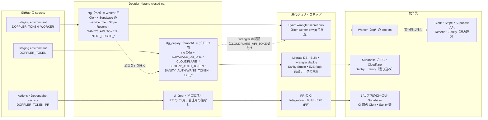

# CI/CD

## パイプライン概要

```
PR (develop・main)
  ├─ TypeScript チェック
  ├─ Lint / Format チェック
  ├─ Unit Tests
  ├─ Gitleaks（PR の commit の機密情報の漏れ）
  └─ E2E Tests（コード変更を含むPRのみ。ローカルSupabase + ローカルdevサーバーで実行）

push (develop・main)
  └─ Deploy
       ├─ [develop] DB マイグレーション (stg) → ビルド → デプロイ → E2E（stg環境に対して）
       └─ [main]    DB マイグレーション (prod) → ビルド → デプロイ
```

| トリガー            | 実行されるジョブ                           |
| ------------------- | ------------------------------------------ |
| PR → develop / main | typecheck・lint・test・E2E（コード変更時） |
| push → develop      | migrate stg → deploy stg → E2E             |
| push → main         | migrate prod → deploy prod                 |

> **PR時のE2Eについて**: `docs/`・`specs/`・`*.md`のみの変更（ドキュメントのみのPR）ではE2Eジョブをスキップする（`dorny/paths-filter`で判定）。実行する場合もstgの本物のDBには触れず、CI実行環境内でSupabaseをローカル起動してテスト用データを使う（PRごとに独立、他のPRのテストと干渉しない）。

> GitHub 無料プランの private リポジトリは branch protection が使えないため、PR なし直接 push のリスクは運用でカバーする。チェックは PR 時のみ実行し、push 時はデプロイのみ行う。

---

## 環境構成

詳細は `requirements.md` の「3. 環境構成」を参照。

| 環境            | ブランチ    | Supabase          | Clerk                                                                     |
| --------------- | ----------- | ----------------- | ------------------------------------------------------------------------- |
| dev（ローカル） | `feature/*` | ローカル Docker   | 「EQ Mart (local)」の Development インスタンス（`legible-swan-6757`）     |
| stg             | `develop`   | 専用プロジェクト  | 「EQ Mart」の Development インスタンス（`natural-griffon-10`）            |
| prod            | `main`      | 専用プロジェクト  | 「EQ Mart」の Production インスタンス                                     |
| PR の CI        | —           | ジョブ内の Docker | 「EQ Mart (CI)」の Development インスタンス（`happy-terrier-8249`、#299） |

> **Clerk の application の分け方**: Webhook の送り先はインスタンスごとに1つのため、データの行き先（接続する DB）ごとに application を分けている（#686）。ローカルで Clerk ユーザーを作っても、その Webhook は stg には届かない。ローカル用のインスタンスの Webhook はメインのチェックアウトの ngrok（`https://buffing-flaccid-nutty.ngrok-free.dev/api/webhooks/clerk`）に届く。Doppler の `dev`（と、それを継承する `dev_personal`）の Clerk のキー・`CLERK_ADMIN_ORGANIZATION_ID` はローカル用のインスタンスのもの、`stg`・`stg_deploy` は stg のもの。ローカル用のインスタンスの設定（サインアップの方式・規約同意・Organization・運営組織のロール等）は stg と同じにしてある。ただし captcha（`auth_attack_protection.bot_protection.captcha_enabled`）は API で有効にできず、ローカル用だけ無効のまま（E2E は Testing Token で captcha を通らないため影響しない）。stg の設定を変えたら、ローカル用・CI 用にも同じ変更をする（`clerk config pull --app <application ID>` で比べられる）。運営組織もインスタンスごとにあり、`CLERK_ADMIN_ORGANIZATION_ID` は config ごとに違う。運営のロールは Clerk に持たず Supabase の `admin_role_assignments` に持つ（issue #390。Clerk のカスタムロール・Role Set は作らない。`docs/domain/admin-rbac.md`）

---

## GitHub Actions Secrets

GitHub リポジトリの Settings → Secrets and variables → Actions に設定する。

### Doppler の config と secret の対応

ジョブは Doppler のサービストークンを `DOPPLER_TOKEN` 環境変数で渡し、`doppler run` で config の値を読む。どの secret がどの config を指すか:

| Secret                 | 置き場所                                         | Doppler の config | 使うジョブ                                                                                    |
| ---------------------- | ------------------------------------------------ | ----------------- | --------------------------------------------------------------------------------------------- |
| `DOPPLER_TOKEN_PR`     | リポジトリの Actions secrets・Dependabot secrets | `ci`（環境 `CI`） | Integration Tests・Build (Cloudflare)・E2E Tests (PR)                                         |
| `DOPPLER_TOKEN`        | `staging` environment                            | `stg_deploy`      | Deploy (staging)・E2E Tests (stg)・商品データの同期                                           |
| `DOPPLER_TOKEN`        | `production` environment                         | `prod_deploy`     | Deploy (production)・商品データの同期                                                         |
| `DOPPLER_TOKEN_WORKER` | `staging` environment                            | `stg`             | Deploy (staging) の Sync Wrangler Secrets & Deploy だけ（Worker の secrets に上げる値を読む） |
| `DOPPLER_TOKEN_WORKER` | `production` environment                         | `prod`            | Deploy (production) の Sync Wrangler Secrets & Deploy だけ                                    |

`DOPPLER_TOKEN_PR` は Actions secrets と Dependabot secrets に同じ値で登録している（Dependabot の PR のワークフローは Dependabot secrets しか読めないため）。作り直すときは両方を入れ替える。

```bash
doppler configs tokens create github-actions-pr -p brand-closed-ec -c ci --access read --plain \
  | tee >(gh secret set DOPPLER_TOKEN_PR --app actions) | gh secret set DOPPLER_TOKEN_PR --app dependabot
```

### PR の CI が読む Doppler の config（`ci`）

PR の CI（Dependabot のセキュリティ更新の PR を含む）では、人間が見る前の新しい版の依存が secret と一緒に動く。依存が乗っ取られていても管理用のトークンが盗まれないよう、PR のジョブは `environment` を使わず、テスト・ビルドに要る値だけを入れた `ci` だけを読む（#671）。

- `ci` は `stg` の branch config ではなく、別の環境（`CI`）の root config にしている（branch config は親の値を引き継ぎ、消せないため）。`stg` の値を変えても `ci` には反映されないので、テストに要る値を足すときは `ci` にも入れる
- 入れないもの: `SUPABASE_DB_URL`・`SUPABASE_ACCESS_TOKEN`・`CLOUDFLARE_API_TOKEN`・`CLOUDFLARE_ACCOUNT_ID`・`SENTRY_AUTH_TOKEN`（ビルドでソースマップを Sentry にアップロードしない）・`SANITY_AUTH_TOKEN`・`RESEND_API_KEY`（PR の CI ではメールを送らない。`DISABLE_EMAIL_SENDING`）・`SUPABASE_SERVICE_ROLE_KEY`・`SUPABASE_PROJECT_REF`（stg の DB に触れない）
- `NEXT_PUBLIC_SUPABASE_URL`・`NEXT_PUBLIC_SUPABASE_ANON_KEY` はローカルの Supabase の既定値（`http://127.0.0.1:54321` と既定の publishable key）。Integration Tests・E2E Tests (PR) はジョブ内で起動したローカルの Supabase の値で上書きし、Build (Cloudflare) はデプロイしないビルドなので埋め込まれても困らない
- Clerk のキー（`CLERK_SECRET_KEY`・`NEXT_PUBLIC_CLERK_PUBLISHABLE_KEY`・`CLERK_WEBHOOK_SECRET`）は CI 専用の Clerk 開発インスタンスのもの（#299）
- `SANITY_API_TOKEN`・`SANITY_WRITE_TOKEN` は CI 専用の Sanity のトークン（ラベル `github-actions-pr-ci`・Editor）。E2E が `staging` データセットに商品を書き込むため Editor にしている。Sanity のトークンはプロジェクト単位で、本番の `production` データセットにも届く（プロジェクトは分けない判断。#671）
- そのほか: `NEXT_PUBLIC_APP_URL`・`NEXT_PUBLIC_SANITY_*`・`NEXT_PUBLIC_SENTRY_*`・`RESEND_FROM_EMAIL`・`RESEND_ADMIN_EMAIL`・`RESEND_TEST_TO`・Stripe のテストモードのキーと `STRIPE_PRICE_ID_*`（`stg` と同じ値）

`tests/unit/deploy-workflow-pr-secrets.test.ts` が、PR のジョブが `environment` を使わず `DOPPLER_TOKEN_PR` だけを読むこと、デプロイのジョブが environment の `DOPPLER_TOKEN`（と Sync の `DOPPLER_TOKEN_WORKER`）だけを読むことを検査する。

### Worker に上げる値と管理用の値を分ける（`stg`・`stg_deploy`）

Worker の実行環境（`process.env`）に管理用のトークンがあると、アプリの穴（issue #666 の `next` の RCE のようなもの）から、本番のインフラを操作できるトークンまで盗まれる。そのため Doppler の config を、Worker に上げる値と、デプロイだけに使う値に分ける（#672）。

stg の例。本番は `production` environment → `prod`・`prod_deploy` → 本番のサービスで、同じ形。



Worker に上がるのは `stg` の値だけで、`stg_deploy` にしかない管理用の値は Worker に届かない。

- **root の `stg`・`prod`** に置くもの: Worker が実行時に使う値（Clerk・Supabase の service role・Stripe・Resend・`SANITY_API_TOKEN`・`NEXT_PUBLIC_*`）
- **branch の `stg_deploy`・`prod_deploy`** にだけ置くもの: `SUPABASE_DB_URL`・`CLOUDFLARE_API_TOKEN`・`CLOUDFLARE_ACCOUNT_ID`・`SENTRY_AUTH_TOKEN`・`SANITY_AUTH_TOKEN`・`SANITY_WRITE_TOKEN`・`SUPABASE_PROJECT_REF`・`E2E_USER_EMAIL`・`E2E_USER_PASSWORD`・`SEED_USER_PASSWORD`。branch は root の値を引き継ぐので、実行時の値を二重に置かなくてよい
- 新しい値を足すときは、Worker が実行時に読むなら root、デプロイ・テスト・スクリプトだけが使うなら branch に置く。リポジトリ側に名前の一覧は持たない
- Sync のステップは、root の値を `scripts/ci/filter-worker-env.jq` に通してから `wrangler secret bulk` に渡す。Doppler が付ける `DOPPLER_*` を落とし、管理用のトークン（`SUPABASE_DB_URL`・`CLOUDFLARE_API_TOKEN`・`SENTRY_AUTH_TOKEN`・`SANITY_AUTH_TOKEN`・`SANITY_WRITE_TOKEN`・`SUPABASE_ACCESS_TOKEN`）を root に置き間違えていたら、Worker に上げずにデプロイを止める（`tests/unit/deploy-workflow-worker-env.test.ts`）
- ローカルで stg の値を使うスクリプトは、要る値に合わせて config を選ぶ。シード（`task supabase:seed-users:stg`）は `SEED_USER_PASSWORD` を使うため `-c stg_deploy`

**root から branch に値を移すとき**: 先に branch に同じ値を書いても、root と同じ値は「引き継ぎ」と扱われて branch には残らない（2026-11-21 に確かめた）。値をシェルの変数に持ったまま、root から消してから branch に書く。失敗したら root の変更は `doppler configs logs rollback <ログID> -c <config>` で戻せる。

```bash
# bash で実行する（zsh では $names が単語に分かれない）
names='<移す名前をスペース区切り>'; keys=$(printf '%s\n' $names | jq -R . | jq -sc .)
vals=$(doppler secrets download -p brand-closed-ec -c stg --no-file --format json | jq -c --argjson k "$keys" 'with_entries(select(.key as $x | $k | index($x)))')
doppler secrets delete $names -p brand-closed-ec -c stg -y
echo "$vals" | doppler secrets upload -p brand-closed-ec -c stg_deploy /dev/stdin --silent; unset vals
```

### 使い道ごとの管理用トークン（Doppler の `stg_deploy`・`prod_deploy`）

デプロイのジョブが使う管理用のトークンは、stg 用と本番用で別のものにする（#673）。stg のデプロイのジョブ・stg の値が漏れても、本番を操作されないようにするため。`stg` と `prod` で同じ値を持たないことは、値のハッシュを比べて確かめる（値は画面に出さない）。

```bash
for k in SUPABASE_DB_URL CLOUDFLARE_API_TOKEN SENTRY_AUTH_TOKEN RESEND_API_KEY SANITY_API_TOKEN; do
  for c in stg_deploy prod_deploy; do
    printf '%s %s %s\n' "$k" "$c" "$(doppler secrets get "$k" -p brand-closed-ec -c "$c" --plain | shasum -a 256 | cut -c1-12)"
  done
done
```

| 値                     | `stg`                                                     | `prod`                       | 使うジョブ・ステップ                                                                                             | 権限・範囲                                                                                                                                                 |
| ---------------------- | --------------------------------------------------------- | ---------------------------- | ---------------------------------------------------------------------------------------------------------------- | ---------------------------------------------------------------------------------------------------------------------------------------------------------- |
| `SUPABASE_DB_URL`      | stg のプロジェクトの DB の接続文字列                      | 本番のプロジェクトの同じもの | Deploy (staging)・Deploy (production) の Migrate DB だけ。Worker の実行環境には上げない（`*_deploy` にだけ置く） | そのプロジェクトの DB だけ。Session pooler（`aws-1-ap-northeast-1.pooler.supabase.com:5432`。GitHub のランナーは IPv6 に繋がらないため直接接続は使わない） |
| `CLOUDFLARE_API_TOKEN` | stg 用のトークン                                          | 本番用のトークン             | Deploy の Sync Wrangler Secrets & Deploy・E2E Tests (stg)                                                        | アカウントの Workers Scripts の Edit だけ。Worker 単位には絞れないため、stg 用のトークンでも本番の Worker に届く（下の「届く範囲を補う」）                 |
| `SENTRY_AUTH_TOKEN`    | stg 用の組織トークン                                      | 本番用の組織トークン         | Deploy の Build（ソースマップのアップロード）                                                                    | `org:ci`                                                                                                                                                   |
| `RESEND_API_KEY`       | stg 用のキー                                              | 本番用のキー                 | Worker の実行環境（メールの送信。`wrangler secret bulk`）                                                        | Sending access・送信元のドメインだけ                                                                                                                       |
| `SANITY_API_TOKEN`     | stg 用のトークン                                          | 本番用のトークン             | ビルド・Worker の実行環境（商品の読み取り）                                                                      | Viewer。プロジェクト単位のため、どちらも両方のデータセットに届く（プロジェクトは分けない判断。#673）                                                       |
| `SANITY_AUTH_TOKEN`    | Studio のデプロイ用（`github-actions-stg-sanity-deploy`） | 入れない                     | Deploy (staging) の Deploy Sanity Studio                                                                         | Deploy Studio だけ                                                                                                                                         |

- **切り替えの状況**（2026-11-21）: 分け終えたのは `SUPABASE_DB_URL` だけ。`CLOUDFLARE_API_TOKEN`・`SENTRY_AUTH_TOKEN`・`RESEND_API_KEY`・`SANITY_API_TOKEN` は、まだ `stg`・`prod` で同じ値（issue #673 で切り替え中。終わったらこの行を消す）
- **`SUPABASE_ACCESS_TOKEN` は CI で使わない**。アカウント単位の個人用のトークンで、stg・本番の両方のプロジェクトを操作できるため。Doppler のどの config にも置かない（置くと `doppler run` が各ステップの環境変数に入れる）。マイグレーションは `supabase db push --db-url "$SUPABASE_DB_URL"` で行う（`supabase link` は要らない）
- **`SUPABASE_DB_URL` の作り直し**: DB のパスワードを作り直すと、古い接続文字列は使えなくなる。パスワードは英数字だけにする（接続文字列はパーセントエンコードが要るため）

  ```bash
  # <config> は stg_deploy か prod_deploy。<ref> は doppler secrets get SUPABASE_PROJECT_REF -c <config> --plain。T は Supabase の個人用トークン
  PW=$(openssl rand -hex 24)
  curl -sf -X PATCH -H "Authorization: Bearer $T" -H 'Content-Type: application/json' \
    -d "{\"password\":\"$PW\"}" https://api.supabase.com/v1/projects/<ref>/database/password
  printf '%s' "postgresql://postgres.<ref>:$PW@aws-1-ap-northeast-1.pooler.supabase.com:5432/postgres" \
    | doppler secrets set SUPABASE_DB_URL -p brand-closed-ec -c <config> --silent
  doppler run -p brand-closed-ec -c <config> -- sh -c 'supabase db push --db-url "$SUPABASE_DB_URL" --dry-run'
  ```

- **トークンを作り直すとき**: 新しいトークンを発行して Doppler に入れ、stg のデプロイ（develop への push）が通るのを確かめてから本番を切り替える。古いトークンは、両方のデプロイが新しいトークンで通ってから各サービスで取り消す（先に取り消すとデプロイが止まる）。ローカル開発で要るもの（`dev` の `RESEND_API_KEY`・`SANITY_API_TOKEN` 等）は、ローカル専用として別に発行する

#### 届く範囲を補う（environment の保護ルール）

Cloudflare・Sanity のトークンは、stg 用でも本番に届く。そのため、トークンを読めるジョブを絞って補う。

- `DOPPLER_TOKEN`・`DOPPLER_TOKEN_WORKER` は `staging`・`production` の environment にだけ置き、environment には、デプロイできるブランチの制限を付ける: `production` は `main` だけ、`staging` は `develop` だけ。制限が無いと、どのブランチの PR でもワークフローに `environment: production` と書けば本番の `DOPPLER_TOKEN` を読めてしまう
- PR のジョブは environment を使わない（上の「[PR の CI が読む Doppler の config](#pr-の-ci-が読む-doppler-の-configci)」）
- 商品データの同期（`product-data-sync.yml`）の定期実行は、GitHub の仕様で既定ブランチ（develop）でしか動かない。本番の同期は、develop の実行が `gh workflow run product-data-sync.yml --ref main` で main の上に起動し直して行う（main にこのワークフローが無い間は飛ばす）

```bash
gh api repos/{owner}/{repo}/environments/production --jq .deployment_branch_policy
gh api repos/{owner}/{repo}/environments/production/deployment-branch-policies --jq '.branch_policies[].name'
```

### 使われていない secrets を溜めない（`task secrets:check`）

リポジトリの Actions secrets・Dependabot secrets・各 environment の secrets には、ワークフローから参照するもの（上の表の `DOPPLER_TOKEN_PR`・`DOPPLER_TOKEN`・`DOPPLER_TOKEN_WORKER`）だけを置く。使われていない secret も、同じリポジトリのブランチからの PR でワークフローを書き換えれば読み出せるため。値は Doppler に置き、GitHub には Doppler のサービストークンだけを置く。

`task secrets:check` が、develop と main の `.github/` のどこからも参照されていない secret と、environment のデプロイできるブランチが上のとおりでないものを出す（`scripts/check-github-secrets.ts`）。secrets の名前の一覧・environment の設定を読む API はリポジトリの管理者の権限が要り、CI の `GITHUB_TOKEN` では読めないため、CI には入れない（入れるには管理者の権限のトークンを CI に置くことになり、本末転倒）。secrets を足し引きしたとき・トークンを作り直したときに、管理者が手元で動かす。

- main の `deploy.yml` が develop より古い間は、main からだけ参照される secret（`CLOUDFLARE_API_TOKEN`・`CLOUDFLARE_ACCOUNT_ID`）も「参照されている」と扱う。develop を main に出したあとで消す
- 消すときは `gh secret delete <名前>`（environment は `--env <名前>`、Dependabot は `--app dependabot`）

### 本番の環境の設定がそろっているか（`task env:check`）

`task env:check -- prod` が、Doppler の `prod`・`prod_deploy` の名前・値（値は出さない）が `stg`・`stg_deploy` とそろっているか・キーが live か、と、Stripe・Clerk・Supabase の本番の設定を、各サービスの API の読み取りで確かめる（`scripts/check-env.ts`。#698）。Doppler の `prod` の読み取り権限が要るため CI では流さず、手元で動かす。確かめる項目と、機械で確かめられない項目のチェックリストは `docs/runbooks/prod-env-checklist.md`。

---

## Cloudflare Workers ランタイムシークレット

Worker の secrets は、デプロイのたびに Sync Wrangler Secrets & Deploy が Worker 用の config（`stg`・`prod`）の値で追加・上書きする（上の「[Worker に上げる値と管理用の値を分ける](#worker-に上げる値と管理用の値を分けるstgstg_deploy)」）。手で `wrangler secret put` しない。

`wrangler secret bulk` は追加・上書きだけで、Doppler から消した値・branch に移した値は Worker に残る。値を消したり移したりしたら、Worker に残っていないかを確かめて消す（stg は 2026-11-21 に掃除済み。本番は初めて main に出すときに issue #681 で行う）。

```bash
# Worker にあって Worker 用の config に無い名前
w=$(doppler run -p brand-closed-ec -c stg_deploy -- pnpm exec wrangler secret list --config wrangler.stg.jsonc | jq -c '[.[].name]')
r=$(doppler secrets download -p brand-closed-ec -c stg --no-file --format json | jq -f scripts/ci/filter-worker-env.jq | jq -c keys)
jq -n --argjson w "$w" --argjson r "$r" '$w - $r'
doppler run -p brand-closed-ec -c stg_deploy -- sh -c 'yes | pnpm exec wrangler secret delete <名前> --config wrangler.stg.jsonc'
```

---

## E2E テスト

### CI での実行タイミング（2種類）

1. **PR作成・更新時**（`e2e-pr`ジョブ）: `docs/`・`specs/`・`*.md`のみの変更を除き、PRを作成・更新するたびにTypeScript/Lint/Unit Testsと同じタイミングで自動実行される。CI実行環境内でSupabaseをローカル起動し、まっさらなDBにマイグレーションを適用してテストする（本物のstg DBには触れない）。Clerk・Stripe・Sanity等のテスト用シークレットはDopplerのCI専用config（`ci`、GitHub Secretsの`DOPPLER_TOKEN_PR`で参照）から取得する（下の「[PR の CI が読む Doppler の config](#pr-の-ci-が読む-doppler-の-configci)」）。`ci`のClerkのキーはCI専用のClerk開発インスタンスのもので、ローカル開発とClerk Backend APIのレート制限の枠を共有しないためのもの（#299）。ローカルSupabaseのClerk連携（`supabase/config.toml`の`[auth.third_party.clerk] domain`）はローカル用のインスタンスを指しているため、ジョブ内でSupabase起動前にCI専用インスタンスのドメインへ差し替える。
2. **`develop`へのpush後**（`e2e`ジョブ、従来通り）: stg デプロイが完了してから自動実行される。stg の応答を最大2分待ってから Playwright を起動し、実際にデプロイされたstg環境に対してテストする。
   全部のE2Eの前に、「環境の確認（スモークテスト）」のステップでデータを書き換えないスモークテスト（`tests/e2e/smoke/`、`pnpm test:e2e:smoke`）だけを流す（#649）。ここで失敗したら全部のE2Eは流さずにジョブが失敗するので、ステップ名から振る舞いの不具合ではなく環境（環境変数・秘密鍵・Workers上のビルド・外部サービスの設定）の問題と分かる。スモークテストは `scripts/seed-users.ts` の既存のアカウント（`docs/seed-data.md`）でログインするため、それが無い使い捨てのDBで動く `pnpm test:e2e`（PRのE2E）には含めない。stgにアカウントが無いときの入れ方は `tests/e2e/smoke/smoke.spec.ts` の冒頭

どちらもE2Eの失敗でジョブが失敗する（PRはマージをブロックされる）。また、E2Eが失敗したときだけ、Playwrightのレポート（`playwright-report/`・`test-results/`。動画・トレースを含む）をageで暗号化して、GitHub ActionsのArtifacts（`playwright-report-pr-<試行回数>`・`playwright-report-stg-<試行回数>`、保持期間3日）としてアップロードする。成功したときは何も残さない。復号して開く手順は「[失敗時のアーティファクト（暗号化）](#失敗時のアーティファクト暗号化)」。

### main への PR で stg の E2E の結果を確かめる（`Stg E2E Check`）

main への PR（develop → main のリリース）では、`.github/workflows/stg-e2e-check.yml` の `Stg E2E Check` が、PR の先端のコミットについて上記2.（`E2E Tests (stg)`）が成功しているかを確かめる（#487。判定は `scripts/ci/check-stg-e2e.ts`）。stg で E2E が通ったコミットだけを本番に出すため、main のブランチ保護の必須チェックに登録している。

- 成功していれば green。失敗・取り消し・スキップ・まだ動いている・そのコミットでは動いていない場合は red で、どの実行・ジョブかのリンクをジョブのログと Summary に出す
- `hotfix/*` → main の PR は stg を通らないため対象外（green で、対象外であることを出す）
- stg の E2E が終わる前に動いて red になったときは、`E2E Tests (stg)` が成功してから PR の Checks で `Stg E2E Check` を「Re-run jobs」で再実行する（`gh run rerun <実行ID>` でもよい）。既存の PR の向き先を後から main に変えたときも動くよう `edited` でも動かしているため、PR 本文を編集しても再実行される
- develop へ続けてマージすると、stg のデプロイ・E2E は直列化され待っている分が取り消されるため、途中のコミットの `E2E Tests (stg)` は取り消し（スキップ）になることがある。リリースは E2E が動いた develop の先端から作る

### ローカルでの実行

```bash
pnpm test:e2e       # pnpm dev を自動起動してテスト
pnpm test:e2e --ui  # Playwright UI モード（ブラウザの動きをリアルタイムで確認できる）
pnpm test:e2e:smoke # スモークテストだけ（docs/seed-data.md のアカウントが要る。ワークツリーでは bash scripts/with-worktree-db.sh を通す）
```

失敗したテストの動画・トレースはローカルでも`test-results/`配下に自動保存される（`playwright.config.ts`の`video: "retain-on-failure"` / `trace: "retain-on-failure"`）。

### 必要な前提条件

E2E テストを実行するには以下が必要：

1. **テスト用 Clerk アカウント**
   - Clerk ダッシュボードでテスト用ユーザーを作成
   - `publicMetadata` に `{ "onboarding_completed": false }` を設定
   - メールアドレスを `E2E_USER_EMAIL`（Doppler の `dev` Config）に設定

2. **環境変数**（ローカルの場合は Doppler、CI の場合は Doppler + GitHub Secrets）

シークレットは `.env.local` 等のローカルファイルではなく Doppler で一元管理する。ローカルで E2E を実行する場合は `task test:e2e`（内部で `doppler run -- pnpm test:e2e` を実行）を使う。

```
E2E_USER_EMAIL=test+clerk_test@example.com
E2E_USER_PASSWORD=...
CLERK_SECRET_KEY=sk_test_...
NEXT_PUBLIC_SUPABASE_URL=https://xxx.supabase.co
SUPABASE_SERVICE_ROLE_KEY=eyJ...
```

### テスト構成

| ファイル                                                     | 内容                                                                                                                                          |
| ------------------------------------------------------------ | --------------------------------------------------------------------------------------------------------------------------------------------- |
| `tests/e2e/auth/onboarding.spec.ts`                          | オンボーディングフロー（プラン選択・リダイレクト。`ticket`方式バイパス）                                                                      |
| `tests/e2e/auth/registration.spec.ts`                        | 実際の招待リンク→登録フォーム→プラン選択→Stripe Checkoutまでの実登録フロー                                                                    |
| `tests/e2e/auth/login.spec.ts`                               | 実際のログインフォーム操作＋未知デバイスの確認コード入力                                                                                      |
| `tests/e2e/order/checkout.spec.ts`                           | カタログ〜チェックアウト〜Stripe Checkout画面遷移（住所新規入力・既存選択・月次上限超過）                                                     |
| `tests/e2e/order/invoice.spec.ts`                            | 要相談商品の見積依頼フロー（カタログ〜チェックアウト〜`/order/invoice-complete`遷移）                                                         |
| `tests/integration/webhooks/stripe-checkout-webhook.test.ts` | Stripe決済確定Webhook（`checkout.session.completed`）受信後、注文が`paid`になることの統合テスト                                               |
| `tests/integration/webhooks/stripe-invoice-webhook.test.ts`  | Stripe請求書決済確定Webhook（`invoice.paid`）受信後、注文が`paid`になることの統合テスト                                                       |
| `tests/e2e/helpers/clerk-test-invitation.ts`                 | 招待作成・テストユーザークリーンアップ・オンボーディング完了までの共通処理（`registration.spec.ts`・`checkout.spec.ts`・`invoice.spec.ts`用） |
| `tests/e2e/global.setup.ts`                                  | Clerk テスト環境のセットアップ                                                                                                                |

`E2E_USER_EMAIL`/`E2E_USER_PASSWORD` が未設定の場合、認証済みアクセス・ログインのテストは自動的にスキップされる。`E2E_USER_EMAIL` は Clerk のテスト用メール規約（`+clerk_test` を含むアドレス）で作成すること。

### Resend メール送信の無効化（`DISABLE_EMAIL_SENDING`）

E2E テストはチェックアウト・Invoice発行等でメール送信コードパスを実際に通過するため、対策なしで実行すると Resend の送信数使用枠を消費してしまう（`e2e-pr`・`e2e`〈stg〉両方）。

`src/infrastructure/resend/client.ts` の `getResend()` は `DISABLE_EMAIL_SENDING=true` の場合、実際の Resend クライアントの代わりに何もしないダミークライアントを返す（`emails.send()` は API を呼ばず `{ error: null }` を返す）。**E2Eテスト実行中だけ**無効化され、stgへの通常デプロイ・手動QA時は常に実送信される設計になっている（Doppler側の設定は変更しない）。

- `e2e-pr`ジョブ: CI内で`next dev`をこのジョブ専用に起動する使い捨てサーバーのため、「Run E2E tests」ステップの`doppler run -- env ...`に`DISABLE_EMAIL_SENDING="true"`を直接渡すだけで、他環境に一切影響しない
- `e2e`（stg）ジョブ: `deploy-stg`でデプロイ済みの実際のCloudflare Workerに対してテストするため、Doppler側の値を変えるとstg環境全体（手動QA含む）に影響してしまう。そこで「Run E2E tests」の直前に`wrangler secret put DISABLE_EMAIL_SENDING`でstg Workerのシークレットを一時的に`true`に上書きし、直後（`if: always()`でテスト失敗時も含む）に`wrangler secret delete`で削除して元の状態（未設定＝実送信）に戻す
- `production`環境・Doppler設定には一切触れない（本番は常に実送信する）

---

## CLI のインストール（Supabase CLI・Doppler CLI）

CI の Supabase CLI・Doppler CLI は、共通の composite action `.github/actions/install-cli` でインストールする（`supabase/setup-cli`・`dopplerhq/cli-action` は使わない。#546）。

```yaml
- uses: ./.github/actions/install-cli
  with: { tool: supabase, version: 2.116.0 }
```

- `github.com/<repo>/releases/download/` は一部のリリースで504を返し続けたことがあるため、同じファイルを API（`api.github.com/repos/<repo>/releases/assets/<id>`。`gh release download` と同じ経路）から取る。トークンは `github.token`（読み取りだけ。fork の PR でも使える）
- 5xx・タイムアウトだけを、間隔をあけて数回やり直す。4xx（403・404・429 等）はやり直さずに失敗する
- 取得したファイルはリリースの `checksums.txt` の SHA-256 と照合してから展開する
- 版はジョブごとに `version` で固定する。上げるときは `tests/unit/workflow-cli-install.test.ts` の `EXPECTED_VERSIONS` も一緒に変える
- gitleaks も同じ手順で入れる（`with: { tool: gitleaks, version: 8.30.1 }`。#663）

---

## 機密情報の漏れの検査（gitleaks）

API キー・秘密鍵・トークンが commit に入っていないかを、[gitleaks](https://github.com/gitleaks/gitleaks) の既定のルールで2か所で確かめる（#663）。GitHub の secret scanning・push protection（2026-11-21 に有効化）は GitHub が形を知っているサービスの鍵しか見ず、commit の前には止められないため。

| 場所       | 何を調べるか                                            | 設定                                               |
| ---------- | ------------------------------------------------------- | -------------------------------------------------- |
| PR の CI   | PR の base から head までの commit（`Gitleaks`）        | `.github/workflows/secret-scan.yml`                |
| pre-commit | commit する差分（`gitleaks git --pre-commit --staged`） | `.husky/pre-commit` → `scripts/gitleaks-staged.sh` |

- 鍵の形をしていない漏れ（例: テスト用のアカウントのパスワード = メールアドレス。#651）は gitleaks でも見つけられない。引き続き `high-risk` の精読で見る
- CI はマージコミットの差分を調べない（gitleaks は `git log -p` を使い、既定ではマージコミットの差分が出ないため）。develop を取り込んだときの衝突の解消で足した値は、ローカルの pre-commit でだけ止まる
- CI は PR のチェックアウトにある `.gitleaks.toml` を読むため、PR が allowlist を広げるとその PR の検査も弱くなる。`.gitleaks.toml`・`.husky/`・`scripts/gitleaks-staged.sh` を `high-risk`（`risk:gate`）の対象にして、人間が精読する
- gitleaks の公式の action は Organization のリポジトリでは有料のライセンスキーが要るため使わない

### ローカルの準備

pre-commit は、gitleaks が入っていなければ入れ方を出して commit を止める（黙って通さない）。CI と同じ版を入れる。

```bash
brew install gitleaks   # macOS。ほかの OS は https://github.com/gitleaks/gitleaks#installing
gitleaks version        # CI の版（.github/workflows/secret-scan.yml の version）と揃っているか
```

### 検出したとき

- **本物の鍵**: 鍵を無効にして作り直す（一度 push した鍵は、消しても漏れたものとして扱う）。履歴の書き換えはしない
- **誤検出**（テスト用のダミーの値・ドキュメントのプレースホルダー等）: `.gitleaks.toml` の `[[allowlists]]` に、`description` に理由を書き、ファイル（`paths`）と値（`regexes`）の両方で絞って足す（`condition = "AND"`）。ディレクトリ全体・ルール全体は外さない。書き方は `tests/unit/gitleaks.test.ts` が検査する

履歴全体を調べ直すときは、全ブランチを取ってから実行する。

```bash
git fetch origin '+refs/heads/*:refs/remotes/origin/*'
gitleaks git --log-opts="--all" --redact --no-banner .
```

---

## 失敗時のアーティファクト（暗号化）

このリポジトリはpublicで、アーティファクトはGitHubにログインした誰でもダウンロードできる。そのため、テストの失敗時に残すものは [age](https://age-encryption.org/) の公開鍵で暗号化し、暗号化したファイル（`.age`）だけをアップロードする。中身に何が含まれていても漏れないよう、値を探して伏せるのではなく暗号化する。

| アーティファクト                       | ジョブ            | 中身                                                                                                                                                                 | 暗号化したファイル             |
| -------------------------------------- | ----------------- | -------------------------------------------------------------------------------------------------------------------------------------------------------------------- | ------------------------------ |
| `supabase-logs-integration-<試行回数>` | Integration Tests | ジョブ内で起動したローカルSupabaseの `supabase_*` のコンテナ（Kong・PostgREST・Postgres・Auth等）のログ。統合テストがときどき502で落ちる原因を追うためのもの（#497） | `supabase-logs.tar.gz.age`     |
| `supabase-logs-e2e-pr-<試行回数>`      | E2E Tests (PR)    | 同上                                                                                                                                                                 | `supabase-logs.tar.gz.age`     |
| `playwright-report-pr-<試行回数>`      | E2E Tests (PR)    | `playwright-report/`・`test-results/`（HTMLレポート・動画・trace.zip）。trace.zipにはブラウザの通信（ヘッダー・本文・Cookie）と画面のスナップショットが入る（#513）  | `playwright-report.tar.gz.age` |
| `playwright-report-stg-<試行回数>`     | E2E Tests (stg)   | 同上（stgに対するテスト）                                                                                                                                            | `playwright-report.tar.gz.age` |

どれも保持期間は3日で、失敗したとき（Playwrightのレポートは E2E のステップが失敗したとき）だけ作る。

- **公開鍵**: `scripts/ci/log-recipients.txt` に置く（1行に1つ。`#` 以降はコメント）。上の全てのアーティファクトで同じ鍵を使う
- **秘密鍵**: CI（GitHub secrets・Dopplerを含む）にもリポジトリにも置かない。復号できるのは、秘密鍵を持つ人の手元だけ
- **fail closed**: 公開鍵のファイルが無い・空・不正なとき、ageのインストールや暗号化に失敗したときは、暗号化のステップが失敗し、何もアップロードしない
- **Actionsのログ**: パス・ファイル名・件数・サイズだけを出す。中身は出さない
- **Dopplerのシークレット**: 暗号化のステップには渡していない
- **暗号化の処理**: `scripts/ci/encrypt-artifact.ts`（`<出力先.age> <パス>...` をtar.gzにまとめて暗号化する）。Supabaseのログを集める `scripts/ci/collect-supabase-logs.ts` も、これを使って暗号化する

### 暗号化しないアーティファクト

`.github/workflows/` のアップロードを足すときは、暗号化するか、ここに理由を書いて対象外にする。`tests/unit/workflow-artifacts-encrypted.test.ts` が、全てのアップロードが `.age` だけを置くか、対象外の一覧にあるかを検査する（一覧は同ファイルの `EXEMPT`）。

| アーティファクト           | ワークフロー            | 対象外にする理由                                                                                                                     |
| -------------------------- | ----------------------- | ------------------------------------------------------------------------------------------------------------------------------------ |
| `pr-diff-summary`          | PR Diff Summary         | PRの差分を区分ごとに集計したMarkdownで、同じ内容をPRのコメントに公開している。publicなPRの差分から作るだけで、シークレットを読まない |
| `mechanical-change-report` | Mechanical Change Check | 機械的な変更の再実行結果のMarkdownで、同じ内容をPRのコメントに公開している。シークレットを読まない                                   |
| `github-pages`             | Issue Deps Graph        | 依存グラフのページで、GitHub Pagesとして公開するためのもの                                                                           |

### 鍵を作る・追加する

```bash
brew install age
age-keygen -o ~/.config/age/brand-closed-ec-ci-logs.txt  # 秘密鍵。コミットしない・共有しない
age-keygen -y ~/.config/age/brand-closed-ec-ci-logs.txt  # 公開鍵（age1...）を表示する
```

表示された公開鍵（`age1...`）を `scripts/ci/log-recipients.txt` に1行で追記し、PRでコミットする。

- 復号する人を増やすとき: その人の公開鍵を同じファイルに1行ずつ足す。どの秘密鍵でも復号できる
- 鍵を外すとき: その行を消す。消す前に作ったアーティファクトは、外した鍵でも復号できる（最長3日で消える）

### ダウンロードして復号する

`<run-id>` は、失敗したワークフロー実行のURL（`.../actions/runs/<run-id>`）の数字。アーティファクト名の末尾は試行回数（再実行なら2以降）。

Supabaseのログ:

```bash
mkdir -p /tmp/supabase-logs && cd /tmp/supabase-logs
gh run download <run-id> -n supabase-logs-integration-1   # E2Eなら supabase-logs-e2e-pr-1
age -d -i ~/.config/age/brand-closed-ec-ci-logs.txt supabase-logs.tar.gz.age | tar -xzf -
ls supabase-logs/   # docker-ps.txt と <コンテナ名>.log
```

Playwrightのレポート（動画・トレース）:

```bash
mkdir -p /tmp/playwright-report && cd /tmp/playwright-report
gh run download <run-id> -n playwright-report-pr-1   # stgなら playwright-report-stg-1
age -d -i ~/.config/age/brand-closed-ec-ci-logs.txt playwright-report.tar.gz.age | tar -xzf -
ls   # playwright-report/ と test-results/

# 以下はリポジトリのチェックアウトで実行する（Playwrightのバージョンを揃えるため）
pnpm exec playwright show-report /tmp/playwright-report/playwright-report
pnpm exec playwright show-trace /tmp/playwright-report/test-results/<テスト名>/trace.zip
```

動画（`test-results/<テスト名>/video.webm`）はそのままブラウザ等で再生できる。

---

## ローカル開発での Webhook テスト

Clerk Webhook をローカルでテストするには ngrok が必要。メインのチェックアウトの `task dev` が ngrok（`buffing-flaccid-nutty.ngrok-free.dev` → `localhost:3000`）も起動する。ローカル用の Clerk インスタンスの Webhook エンドポイントはこの URL に登録済みなので、ダッシュボードでの操作は要らない。ngrok が止まっている間に届かなかったイベントは、Clerk（Svix）が間隔を空けて再送を試みる。

ローカル用のインスタンスは stg と別のため、ローカルのイベントが stg に届くことも、stg のイベントがローカルに届くことも無い（#686）。
